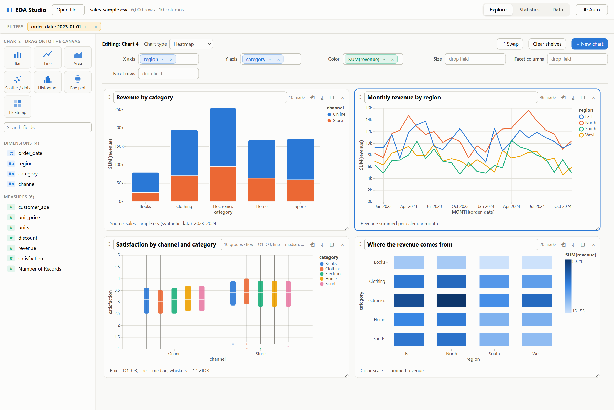
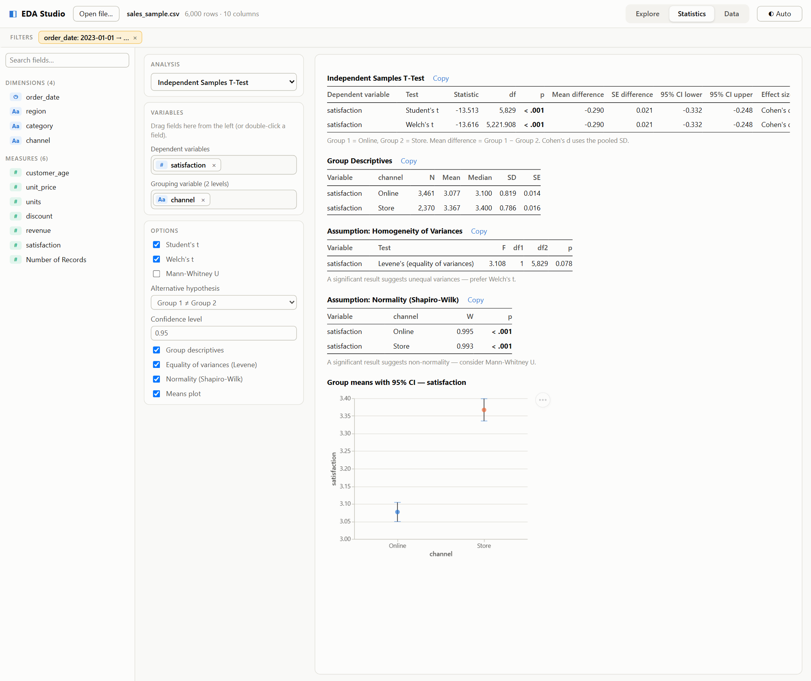
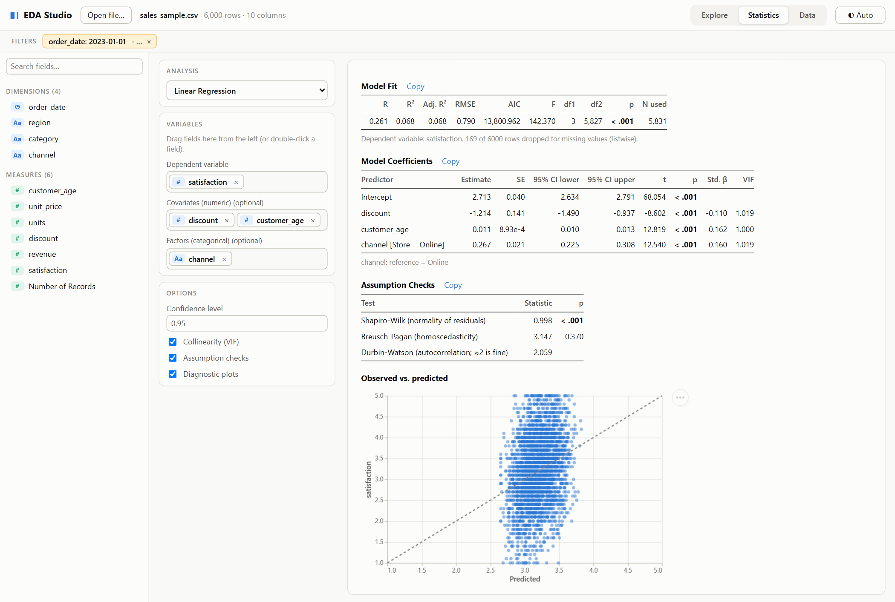

<div align="center">


# EDA Studio

**Drag-and-drop exploratory data analysis with Jamovi-style statistics — a fast, local desktop tool.**

Build several charts side by side like in Tableau, then run a t-test, ANOVA, correlation or regression on the same data without leaving the window.


-2ea44f?style=flat-square)


<br>

<picture>
  <source media="(prefers-color-scheme: dark)" srcset="docs/screenshots/dashboard-dark.png">
  
</picture>

</div>

---

## Why

Python notebooks are great, but the loop *“load → plot → tweak → plot again”* is slow when you just want to get to know a dataset.
EDA Studio keeps that loop to a few drags: nothing is charted automatically, **you decide** what goes on each axis, and the numbers are computed in a real database engine, so a few million rows feel instant.

- **Your data stays on your machine.** It runs locally and never calls out to any service.
- **No install.** A portable folder — copy it anywhere and double-click `EDAStudio.exe`.
- **Trustworthy statistics.** Results are tested against `scipy` and `statsmodels`.

## Features

<table>
<tr>
<td width="33%" valign="top">

### 🧩 Explore
- **Canvas of charts** — drag chart types from a palette; resize, reorder, duplicate
- Bar · line · area · scatter · histogram · box plot · heatmap
- **Shelves**: X, Y, Color, Size, Facet columns / rows
- Click a pill to change **aggregation**, **date part** (year … hour, month-of-year, weekday) or **bin size**
- **Title & footnote** on every chart; export PNG (including them) or copy to the clipboard
- Global **filters** that apply to every view
- Light / dark / auto theme

</td>
<td width="33%" valign="top">

### 📐 Statistics
- Descriptives (with split-by and histograms)
- **T-tests** — independent, paired, one-sample; Student, Welch, Mann-Whitney, Wilcoxon
- **One-way ANOVA** — Fisher, Welch, Tukey post hoc, η² / ω²
- **Correlation matrix** — Pearson, Spearman, Kendall + heatmap
- **Linear regression** — numeric and categorical predictors, standardized β, VIF
- Assumption checks and diagnostic plots built in
- APA-style tables with a one-click **Copy** (paste straight into Excel)

</td>
<td width="33%" valign="top">

### 🗂️ Data
- CSV / TSV, **JSON & NDJSON** (e.g. BigQuery exports), Parquet, Excel with sheet picker
- Hebrew-friendly: falls back to Windows-1255 for legacy CSVs
- Column profile: type, missing %, unique, min / max / mean / SD
- Paged row preview that respects your filters
- Drag a file onto the window, use the file dialog, or paste a path
- **Millions of rows** — charts are aggregated in the database, scatter plots show a random sample

</td>
</tr>
</table>

### Statistics in action

<table>
<tr>
<td width="50%"></td>
<td width="50%"></td>
</tr>
<tr>
<td align="center"><sub>Independent samples t-test: Student + Welch, effect size, assumptions, means plot</sub></td>
<td align="center"><sub>Linear regression: fit, coefficients with std. β and VIF, assumption checks</sub></td>
</tr>
</table>

## Getting started

### Option A — portable build (recommended)

1. Build it once: `.\build_portable.ps1` *(needs the Python environment below)*, or copy a finished `portable\EDAStudio` folder.
2. Double-click **`portable\EDAStudio\EDAStudio.exe`**.

No installer, no admin rights, no Python needed on the target machine. Keep the whole folder together.
The window uses the Edge WebView2 runtime that ships with Windows 11.

> The first start on a new machine can be slow while security software scans the new files.

### Option B — run from source

```powershell
python -m venv .venv
.\.venv\Scripts\python.exe -m pip install -r requirements.txt

.\.venv\Scripts\python.exe run.py             # desktop window
.\.venv\Scripts\python.exe run.py --browser   # or your default browser
```

### Run the tests

```powershell
.\.venv\Scripts\python.exe -m pytest tests
```

## Performance

Tested on 3 million rows (250 MB CSV): load ≈ 6–10 s · aggregated chart 0.02–0.6 s · ANOVA ≈ 1 s · linear regression with a 10-level factor ≈ 8 s.

## Project layout

```
run.py                  launcher (desktop window or browser)
build_portable.ps1      PyInstaller build -> portable\EDAStudio
app/
  main.py               FastAPI routes
  datastore.py          file loading, profiling, filters (DuckDB)
  charts.py             shelf spec -> SQL
  stats.py              statistical analyses (slots/options -> result blocks)
  static/               index.html, style.css, js/*.js, vendor/ (Vega-Lite)
tests/test_api.py       API tests incl. numeric checks against scipy / statsmodels
scripts/                sample-data and README-screenshot generators
sample_data/            small synthetic dataset to try the tool
```

## Roadmap

- [ ] Logistic regression, chi-square, interaction terms
- [ ] Save / load a workbook (canvas + filters + analyses)
- [ ] Export a whole canvas as one image / report
- [ ] Top-N categories, reference lines, calculated fields
- [ ] Flatten nested JSON (STRUCT / LIST columns are shown but not plottable yet)
- [ ] Reference-level picker for regression factors in the UI

---

<div align="center"><sub>Built with FastAPI, DuckDB, scipy, statsmodels and Vega-Lite.</sub></div>
